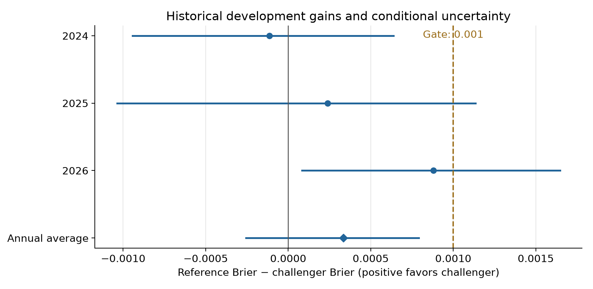

# Experiment 01: completed; continuation gate failed

October 12, 2026. Owner: Tom. Scope: the one approved offline regular-season
team-strength comparison. **Retain the existing native reference. Do not promote
this challenger or start another variant automatically.** The comparison finished
within the five focused working-day effort cap; no calendar waiting was required.

## Question and frozen comparison

Does an opponent-adjusted, dynamically weighted run rating improve the existing
native starter model enough to justify taking that challenger forward? One rating
replaced six rolling team-strength inputs, retaining season progress and the
three starter features. Half-life 60 calendar days, preceding-season factor 0.5,
ridge penalty 20; logistic C=1, training-only scaling, no market inputs or
post-fit calibration. [Protocol](PROTOCOL.md) and code were committed in
`5cf2f42` before challenger execution. This was one specification, with no tuning.

## Paired results

Lower scores are better. Gain = reference Brier minus challenger Brier;
positive favors the challenger. Each annual fit used only earlier seasons;
within-season ratings used earlier completed calendar days.

| Development season | Games | Reference Brier | Challenger Brier | Brier gain | Reference log loss | Challenger log loss |
|---|---:|---:|---:|---:|---:|---:|
| 2024 | 2,426 | 0.243134 | 0.243249 | −0.000115 | 0.679228 | 0.679490 |
| 2025 | 2,426 | 0.243886 | 0.243647 | +0.000239 | 0.680590 | 0.680060 |
| 2026 | 2,428 | 0.246136 | 0.245258 | +0.000879 | 0.685346 | 0.683490 |
| Pooled | 7,280 | 0.244386 | 0.244051 | +0.000334 | 0.681722 | 0.681014 |

The primary equal-weight annual gain is **0.000334224**, only about one third
of the required **0.001**. It is distinct from the nearly identical pooled gain
0.000334374, which weights years by game count. The primary 14-day conditional
95% interval is [−0.000256781, +0.000790124]; seven-day sensitivity is
[−0.000200123, +0.000772502]. Both span zero.

| Predeclared continuation condition | Result |
|---|---|
| Average annual Brier gain at least 0.001 | **Fail** |
| Positive Brier point gain in at least two years | Pass: 2025 and 2026 |
| Pooled log loss no worse | Pass |
| Identical target coverage | Pass: all 7,280 paired games |
| No new hindsight dependence | Pass within the stated historical availability assumptions |

All conditions were required. The stronger 2026 result does not override the
failed average-gain condition. Its annual 14-day Brier interval
[+0.000084017, +0.001646547] is a conditional development finding, not an untouched
holdout or justification for selecting only 2026.

Calibration slopes (reference → challenger) were 0.987 → 1.011 in 2024,
0.843 → 0.860 in 2025 and 0.782 → 0.888 in 2026. These are descriptive diagnostic
fits, without uncertainty intervals or any applied calibration correction.
The apparently improved 2026 slope does not rescue the gate.

## Verification and limitations

The reference refits reproduce saved annual probabilities **exactly** in all
three seasons. Original source checksums verify all 32 pinned files, overlapping
feature versions agree, target IDs/labels match, and all canonical history rows
are valid. All 914 rating-date source sets respect the season and available-day
rules; no empty-history fallback dates occurred. Existing starter inputs and
their missing-history fallbacks were reused unchanged.

Five synthetic equation/chronology checks passed: target/same-day/future
independence, resumed availability, invalid-history rejection, neutral-game
shrinkage and prior-year discount/empty-history fallback. Independent augmented
least-squares solves on 15 outcome-blind first/middle/last dates agree with the
constrained rating solver within 3.45e-15. Saved challenger probabilities
reconstruct within 2.23e-16. Annual scores were independently recomputed using
standard-library arithmetic. All seven saved model-run artifacts reproduced
byte for byte in a separate output directory, including bootstrap results.
These are independent numerical checks by this task, not a separate reviewer.

All 2024–2026 seasons were reused development. Calendar-block intervals condition
on fitted forecasts and omit selection, training and future-regime uncertainty.
Historical actual starter identity, later data corrections, conservative
prior-day cutoff and the fixed source-based neutral-venue classification remain
limitations. Raw player-feature acquisition was not rebuilt or freshly audited.
The one resumed game whose venue changed was handled only after completion;
both venues had the same non-neutral indicator. No performance-based exclusions.

No new sportsbook or Kalshi comparison was run. The reviewed 2026 sportsbook
opening-consensus Brier of 0.243581 remains useful historical context and is still
lower than this challenger's 0.245258. Opening quotes are not same-time Kalshi
probabilities or executable asks. No selected paper-entry returns were simulated.
No edge, undervaluation or profitability claim follows.

The [executed notebook](comparison.ipynb) contains four successful code cells,
aggregate tables and the interval chart. Its standalone PNG was visually
inspected and an overlapping legend was repaired. HTML export succeeded, but
full rendered notebook layout inspection was unavailable: browser security
blocked local-file navigation. This is a presentation limitation, not an
unfinished numerical experiment. To inspect locally, open the notebook in
Jupyter, or run `jupyter nbconvert --to html comparison.ipynb` and open the HTML.

## Record and next boundary

The approved comparison is complete and failed its continuation gate. Keep the
reference as the research baseline; no second challenger, parameter retuning or
gate relaxation has been launched. Tom can separately discuss whether to pause
accuracy development or prioritize the paper workflow with an explicitly
unvalidated model. That discussion does not assert useful selected returns.

No production collectors, pins, schedules, credentials, licensed raw data,
postseason protocols or historical results were changed. GitHub PR #86 stays
draft and unmerged. No forward implementation handoff is issued because the
candidate did not pass its acceptance gate.

Supporting aggregate records: [results](results.json), [verification](verification.json),
[reference replay](reference_replay.json), [provenance](provenance.json),
[source manifest](input_manifest.json). Licensed per-game inputs, model/scaler
artifacts, predictions and detailed source lineage remain in private local
outputs. The runner takes `--source-root` and `--output` explicitly; use a new
output directory for a full replay, with the pinned modeling requirements.
