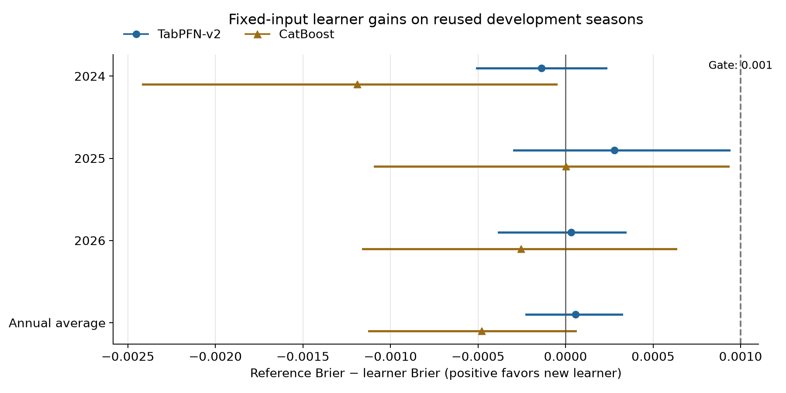
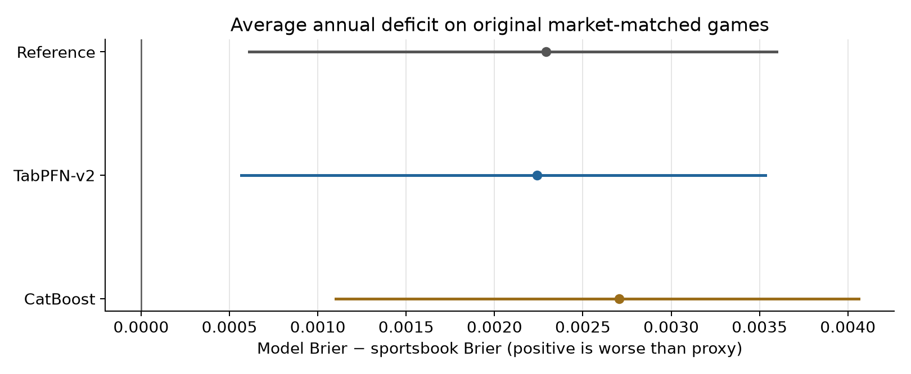

# Experiment 02: v2 feasible locally; both learner gates failed

October 12, 2026. **Complete within the approved five-working-day effort cap.
Retain the existing reference; promote neither TabPFN-v2 nor this CatBoost fit.**
Built with PriorLabs-TabPFN.

The modern-AI hypothesis received a direct bounded test: one official v2 checkpoint
and one training-only-tuned boosting baseline on the unchanged ten-input table.
It did not produce the required predictive improvement. No more checkpoints,
calibration variants or feature experiments follow automatically.

## Authority and setup outcome

Tom approved v2 in the interim while the separate 3.5 inquiry remains pending.
The [protocol](PROTOCOL.md), [settings](SETTINGS.json), source pins and runner were
committed/pushed in `041f608` before baseball fitting. No 3.5 license acceptance,
login, account/key creation, hosted model API or paid compute occurred.

The official v2 default checkpoint and its unchanged Prior Labs v1.1 license were
checksum-verified. Private local acquisition required no credentials. Isolated
Python 3.14.5, TabPFN 9.1.0 explicitly executing **v2**, PyTorch 2.14.1, CatBoost
1.2.10, NumPy 2.5.3, SciPy 1.18.1 and sklearn 1.9.1 imported successfully.
Production/reference environments stayed intact. Initially, sandboxed import/cache
and GPU visibility needed explicit workspace cache paths and Metal-device
escalation; these were corrected before model use, without changing the model.

Small synthetic CPU/Metal tests, full 9,704-row synthetic Metal capacity and
test-row-independence checks passed. Model-use processes disallow network/DNS and
point explicitly to the verified v2 file; no latest-version auto-download.
The v2 paper describes synthetic-task pretraining; this is developer-reported
provenance, not our independent corpus audit. V2 is an older foundation model,
not the 3.5 or proprietary Thinking/Plus variants.

## Full native population

Lower Brier and natural-log loss are better. Positive gain means reference
Brier minus v2 Brier. All forecasts use identical eligible games within each year.

| Reused development season | Games | Reference Brier | CatBoost Brier | V2 Brier | V2 gain |
|---|---:|---:|---:|---:|---:|
| 2024 | 2,426 | 0.243134 | 0.244324 | 0.243272 | −0.000138 |
| 2025 | 2,426 | 0.243886 | 0.243882 | 0.243605 | +0.000280 |
| 2026 | 2,428 | 0.246136 | 0.246390 | 0.246105 | +0.000031 |
| Pooled | 7,280 | 0.244386 | 0.244866 | 0.244328 | +0.000058 |

| Season | Reference log loss | CatBoost log loss | V2 log loss |
|---|---:|---:|---:|
| 2024 | 0.679228 | 0.681692 | 0.679490 |
| 2025 | 0.680590 | 0.680708 | 0.680013 |
| 2026 | 0.685346 | 0.685907 | 0.685312 |
| Pooled | 0.681722 | 0.682770 | 0.681606 |

Primary equal-weight annual v2 gain is **0.000057915**, versus required **0.001**.
The 14-day conditional 95% interval is [−0.000224890,+0.000320501], spanning zero.
Both annual and pooled measures are shown; pooled gain 0.000057907 weights games
instead of seasons and is not silently substituted for the primary measure.

CatBoost's primary average gain is **−0.000479901**, interval
[−0.001122217,+0.000057721]. It improves Brier only very slightly in 2025 and
worsens the other years. Its pooled log loss is also worse. The eight configurations
were selected strictly inside each annual training pool; selected final tree
counts were 63/118/112. All inner scores and fitted tree files stay private.

| Predeclared development condition | V2 | CatBoost |
|---|---|---|
| Average annual Brier gain >=0.001 | Fail | Fail |
| Positive point gain in at least two years | Pass | Fail |
| Pooled log loss no worse | Pass | Fail |
| Identical coverage | Pass | Pass |
| No new hindsight dependence within declared assumptions | Pass | Pass |
| **All conditions required** | **Fail** | **Fail** |

## Sportsbook proxy: exact original market intersection

The opening consensus remains the agreed historical Kalshi proxy. Original
eligibility retains 2,291/2,425/2,428 games, total **7,144**, without introducing
the old outcome-inspected 13-game exclusion list. Missing market coverage is
135/1/0 by year and stays visible; none of those 136 games is dropped from the
full native comparison above. Compare these scores only within this population.

| Season | Games | Sportsbook Brier | Reference Brier | V2 Brier | CatBoost Brier |
|---|---:|---:|---:|---:|---:|
| 2024 | 2,291 | 0.242288 | 0.243999 | 0.244152 | 0.244967 |
| 2025 | 2,425 | 0.241249 | 0.243860 | 0.243582 | 0.243882 |
| 2026 | 2,428 | 0.243581 | 0.246136 | 0.246105 | 0.246390 |
| Pooled | 7,144 | 0.242375 | 0.244678 | 0.244622 | 0.245082 |

Pooled common-population log losses: sportsbook **0.677902**, reference 0.682318,
v2 0.682209, CatBoost 0.683208. The proxy has lower Brier and log-loss point scores
than every native learner in **each** annual comparison.

V2's equal-weight annual Brier deficit versus the proxy is **0.002240293**, with
conditional 14-day interval [+0.000568152,+0.003533211]. Seven-day sensitivity
and every annual/common contrast are retained in [results](results.json).
Do not explain away this deficit by presuming materially different Kalshi odds.
Opening quote timing/identity limitations remain disclosed, not a new benchmark.

On the full native population, v2 beats the bounded CatBoost control by 0.000538
average Brier (conditional interval [+0.000018,+0.001158]); on their market-common
population, that contrast's interval spans zero. Outperforming this control does
not rescue the failed practical reference gate or imply market superiority.

## Calibration, runtime and validation

Full-population calibration slopes (reference/CatBoost/v2): 2024
0.987/1.337/0.947; 2025 0.843/1.024/0.861; 2026 0.782/0.859/0.800. These are
descriptive fits, with no calibrated predictions or tuned decision threshold.
The v2 wrapper's fitted temperature stayed at its predefined default **0.9** and
tuning_config was None. Mean probability and all ten-bin diagnostics are retained.

Actual v2 fit times were approximately 8.3/21.3/55.2 seconds; annual forecast
prediction took 5.0/9.7/12.4 seconds. Total fit/predict computation was about
112 seconds, excluding package setup, fitted-context serialization and verification.
CatBoost selection plus final fit/predict took approximately 0.45/1.78/3.87 seconds.
Metal driver memory after prediction stayed around 1.16–2.23 GB; this is not a
measured peak GPU allocation. The conservative memory guard remained in place.
Private fitted v2 caches total roughly 2.8 GiB; no cloud fee was incurred.

The following checks passed:

- All 38 pinned source files and the checkpoint digest verified; original
  annual reference probabilities reproduced exactly in the isolated environment.
- All 7,280 v2 and CatBoost forecasts replayed **exactly** from saved fitted
  artifacts; fixed later-test-row feature mutations changed earlier forecasts by
  zero in each actual annual context. No subsequent model/temperature adjustment.
- Chronological training/inner selection, chosen configuration/tree count and
  unchanged game/label/market joins verified. No outer-year validation data entered
  boosting selection or a v2 fitting context.
- Annual/full/common and pooled proper scores independently recomputed;
  calibration score equations residual <=3.80e-14. Every bootstrap bound was
  independently reconstructed using individual-game resampling weights instead
  of the runner's daily loss sums; maximum difference 2.43e-17.
- No invalid probabilities, target drops, extra market exclusions, 3.5 files,
  model API uploads or production mutations occurred.

This is separate numerical verification by this task, **not an external reviewer**
or a full raw feature-builder rerun. Original source corrections, actual historical
starter assumption, unresolved provider-ID fragmentation in inherited histories
and prior-day cutoff remain limitations. Calendar blocks do not capture all team,
cross-season, model-selection or fitted-parameter uncertainty. All evaluated years
remain development despite chronological fits.

The [aggregate notebook](comparison.ipynb) contains five executed code cells,
two figures and inspectable tables; its figure/layout verification status is
recorded in the [presentation receipt](presentation_verification.json). No private fitted context, checkpoint,
per-game prediction or licensed provider payload is committed.

## Decision and next boundary

Operational feasibility passed; predictive continuation failed. Preserve both
learners and every result as research artifacts. **Keep the existing reference
and stop this learner comparison without retuning.** No v2 promotion, new
checkpoint, larger boosting search, post-fit calibration, paper policy or trading
is authorized by these results.

This tests one v2 learner on a compressed existing representation. A hierarchical
player/event model or other richer representation remains an untested structural
proposal requiring its own data readiness, hypothesis, protocol and Owner decision.
The setup/result does not authorize that next fit or presume it will beat the proxy.
The separate 3.5 inquiry remains pending; no access or output-use rights inferred.

Draft PR #86 stays unmerged. Existing regular/postseason collection, T−6h rules,
production pins/schedules and prior model experiments retain their identities.
No live opportunity, net-return or profitability claim follows.

Supporting records: [model/split verification](verification.json),
[independent measurement check](measurement_verification.json),
[reference replay](reference_replay.json), [timings](timings.json),
[provenance](provenance.json), [checkpoint pin](checkpoint_pin.json).
Private source/fitted-model/prediction locations are retained locally, outside Git.
